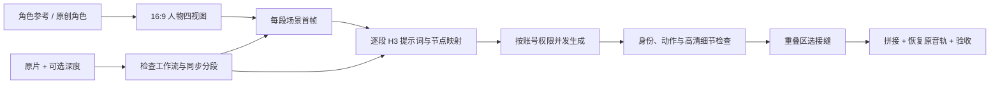

# RunningHub Character Replacement

把原视频的人物替换为指定角色，并尽量保留动作、场景、机位和原音轨。一个可安装的 **Codex Skill**，附带可独立使用的 Python CLI；面向 RunningHub 自定义工作流，包含 MiniMax H3 Ref2VA / T8 的可选适配。

**v0.1.0 · 中文工作流说明 · MIT（本仓库代码与原创文档）**



## 包含什么

- 人物四视图、每段场景首帧与 H3 多参考提示词模板。
- 按实际时长限制和帧数约束同步切分原片/深度，保留重叠区。
- 检查节点类型、输入字段和输出分支；可配置 LoRA / 高清链参数。
- 真正覆盖整个生成生命周期的并发，按素材哈希复用上传。
- 保存任务 ID、输入指纹和结果哈希；断点续跑复用已提交任务。
- 提交结果不明时停止自动重发，降低重复扣费风险。
- 按全局帧边界拼接，复制原音频流并校验音频内容哈希。

图片生成由使用 Skill 的智能体调用当前环境图像工具完成。CLI 本身不调用生图模型，也不自动生成深度视频。

## 安装到 Codex

需要 Python 3.10+、Git、FFmpeg（包含 ffprobe），以及带相应 API 权限的 RunningHub 账号。生成角色图时还需要当前智能体具备图像生成能力，或自行提供图片。

```bash
git clone https://github.com/0xMomo-NGClubs/runninghub-character-replacement.git \
  "${CODEX_HOME:-$HOME/.codex}/skills/runninghub-character-replacement"
cd "${CODEX_HOME:-$HOME/.codex}/skills/runninghub-character-replacement"
python3 -m venv .venv
.venv/bin/python -m pip install -r requirements.txt
ffmpeg -version
ffprobe -version
```

Windows 可将 Python 路径替换为 `.venv\Scripts\python.exe`。也可下载 [Releases](https://github.com/0xMomo-NGClubs/runninghub-character-replacement/releases)，将解压后的技能文件夹放入 Codex 的 skills 目录。

重新打开 Codex 聊天后输入：

> 使用 $runninghub-character-replacement，把我的原视频人物替换为指定角色。这里是原视频、同步深度视频和 RunningHub 工作流 ID。先检查实际节点与时长限制；我的账号支持两并发，优先保留原动作。角色图按 16:9 四视图生成，成片保持原视频画幅。

也可以只要求分析或提示词；Skill 会按请求范围执行。实际生成会上传所选素材，并产生平台费用。

## 首次接入

凭证通过环境变量注入；不要放进 prompt、项目 JSON 或 Git 仓库。CLI **不自动读取 .env**，`.env.example` 只用于说明变量名。

```bash
export RUNNINGHUB_API_KEY='在本地填入自己的密钥'
export RUNNINGHUB_BASE_URL='https://www.runninghub.ai'
```

国内站账号按实际归属使用 `https://www.runninghub.cn`。切换地区前先核对账号，不自动跨站试密钥。安装目录只存技能；所有素材与运行状态放在单独项目目录。

工作流必须由使用者提供并具有调用权限。本仓库没有附带第三方工作流完整图、模型权重或 LoRA 文件。集成接口与恢复说明见 [RunningHub 接入](references/runninghub.md)。

## CLI 示例

以下在你自己的项目目录运行。把 `SKILL_DIR` 指向安装目录，`PY` 指向它的虚拟环境解释器。

```bash
SKILL_DIR="${CODEX_HOME:-$HOME/.codex}/skills/runninghub-character-replacement"
PY="$SKILL_DIR/.venv/bin/python"

"$PY" "$SKILL_DIR/scripts/rh_replace.py" probe source.mp4
"$PY" "$SKILL_DIR/scripts/rh_replace.py" prepare \
  --source source.mp4 --depth depth.mp4 --out work/media \
  --fps 24 --reference-limit 15 --output-limit 15 --overlap 1

"$PY" "$SKILL_DIR/scripts/rh_replace.py" fetch-workflow \
  --workflow-id YOUR_WORKFLOW_ID --out work/workflow.private.json
"$PY" "$SKILL_DIR/scripts/rh_replace.py" inspect-workflow work/workflow.private.json
cp "$SKILL_DIR/assets/project.example.json" project.json
```

随后由智能体或你自己完成配置：

1. 制作 [人物四视图](assets/four-view-prompt.md)，再按每段真实起始姿势制作 [场景首帧](assets/keyframe-prompt.md)。
2. 为每段填写 [H3 提示词](assets/h3-reference-prompt.txt)，替换所有 `{{...}}`；无深度时删除 `<Video 2>` 相关定义和描述。
3. 用实际工作流填写 `workflow_id`、`bindings`、`output_nodes` 和可选 `overrides`，核对节点类型及执行分支。
4. 根据 `work/media/manifest.json` 的 `segments` 完整填写项目片段。复制各段 `id`、`duration_seconds`、`frame_count`，设置 `rgb` / `depth` 为 `work/media/` 下对应文件，补齐 `keyframe` / `prompt_file`。所有相对路径以 `project.json` 所在目录为基准。
5. 根据实际账号设置 `concurrency`；核对实例档位及当前模型限制。

配置完成后：

```bash
# 本地编译检查：不上传、不提交任务
"$PY" "$SKILL_DIR/scripts/rh_replace.py" compile project.json

# 可选：需要样段验收时先跑代表片段
"$PY" "$SKILL_DIR/scripts/rh_replace.py" run project.json --only S001

# 账号确实支持两并发时；重复执行会复用成功结果和已提交任务
"$PY" "$SKILL_DIR/scripts/rh_replace.py" run project.json --concurrency 2
```

同一个状态目录同时只运行一个 CLI 进程；进程内部负责多段并发。默认输出在 `work/runninghub/generated/`。更改输入、提示词、节点、质量参数、工作流、地区或凭证后，用新的片段 ID 或状态目录，避免混用旧结果。上传缓存按执行上下文隔离。

检查片段并在重叠区选择接缝；以下示例为两段，中间的 `CUT_FRAME` 替换为核对过的全局帧边界。三段则提供三个片段和两个边界，依此类推：

```bash
"$PY" "$SKILL_DIR/scripts/rh_replace.py" stitch work/media/manifest.json \
  --clips work/runninghub/generated/S001.mp4 work/runninghub/generated/S002.mp4 \
  --cuts CUT_FRAME --audio work/media/original-audio.mka --out final.mp4
"$PY" "$SKILL_DIR/scripts/rh_replace.py" verify final.mp4 \
  --audio work/media/original-audio.mka
```

省略 `--cuts` 会使用重叠中点，但仍需人工观看接缝。原片无音频时省略 `--audio`。MP4 不兼容原音频编码时，可改用兼容容器，或另行明确转码。

## 关键限制与质量取舍

| 项目 | 正确用法 |
|---|---|
| 时长 | 以当前模型和工作流为准。示例 15 秒不是永久模型规格；可在配置和切分参数中调整。 |
| 多路参考 | 若当前限制是参考视频总计 15 秒，RGB + 深度各占时长，每段通常不能超过 7.5 秒。 |
| 帧数表达式 | 只有核对为 `5+17n` 时才给 prepare 加 `--modulus 17 --remainder 5`。 |
| 节点号 | 示例 6 / 35 / 79 / 80 等均可替换，不是通用 API 常量。 |
| T8 适配 | `t8_conditioning_nodes` 仅用于确认兼容的 MiniMaxH3AudioConditioningT8；其他节点使用自己的映射/适配。 |
| LoRA | “65 节点”“0.5 / 1.0”是特定工作流案例。先追踪实际 LoRA、强度和执行链，再比较清晰度与动作保留。 |
| 高清 | 像素增加不等于脸、手和道具结构修复；优先比较同段实物效果。 |
| 背景与动作 | 生成模型不能保证像素级背景不变或逐帧动作一致；严格保留通常需要遮罩/合成或更强控制。 |
| 同步 | 深度应与原片同一时间基准。脚本检查时长，但无法据此证明空间注册和动作事件完全一致。 |

## 恢复任务

- 查询失败或等待超时：暂停新片段提交，直接再次运行 `run` 继续跟踪原任务。恢复时需包含仍未完成的片段，不能用 `--only` 跳过它们以新增任务替代未知槽位。
- 创建超时、HTTP 5xx、缺少 taskId：先在平台历史确认，再 `attach project.json --segment S001 --task-id ID` 绑定已确认任务。不要自动重发。
- 平台明确生成失败：检查原因；确需再次提交时用 `run ... --retry-failed`。这是新的付费尝试。
- 成功结果改变：脚本拒绝直接复用哈希不一致的文件，先确认文件来源。

## 测试

```bash
python -m pip install -r requirements.txt
python -m unittest discover -s tests -v
python -m compileall -q scripts tests
```

测试使用模拟 API 和合成视频，覆盖同步分段、组合参考时长限制、节点检查、并发、任务恢复、拼接与音轨一致性，**不调用付费模型**。GitHub Actions 使用同一套测试；它不证明任意第三方工作流都能执行，也不替代成片视觉验收。

详细入口：[SKILL.md](SKILL.md) · [H3 提示词职责](references/h3-prompts.md) · [质量与验收](references/quality-and-qa.md)

## 许可

本仓库原创代码和文档采用 [MIT](LICENSE)。RunningHub、MiniMax、第三方工作流、模型、LoRA 和用户素材各自的许可、费用与使用条件不因本仓库改变。公开包不包含私人视频、角色图、密钥、账号运行状态或私有工作流图。
